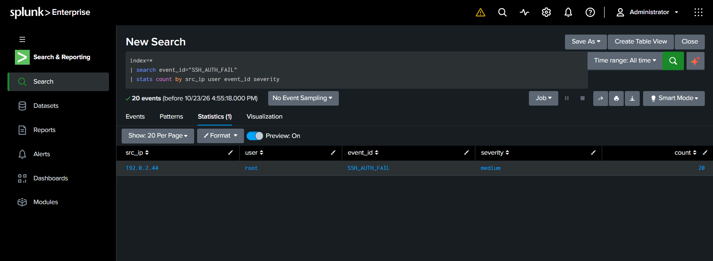

# Investigation 01: Failed SSH Authentication

## Objective

Identify repeated failed SSH authentication events using Splunk.

## Tools

* Splunk Enterprise
* Search Processing Language (SPL)

## SPL Query

```spl
index=*
| search event_id="SSH_AUTH_FAIL"
| stats count by src_ip user event_id severity
```

## Findings

* Source IP: 192.0.2.44
* Target username: root
* Event type: SSH_AUTH_FAIL
* Severity: Medium
* Matching event count: 20

## Analysis

The logs contain 20 matching failed SSH authentication events associated with the same source IP and username.

Repeated failed authentication can indicate password guessing or another authentication issue. The available evidence is insufficient to confirm an attack.

## Recommended Next Steps

1. Check the event timestamps and determine whether the events occurred within a short period.
2. Verify whether successful logins followed the failures.
3. Review related authentication logs and source IP context.
4. Check for duplicate events caused by repeated data ingestion.
   
## Evidence



*Splunk results showing failed SSH authentication events grouped by source IP, username, event type, and severity.*

## Conclusion

This exercise demonstrates how Splunk can identify and summarize failed SSH authentication events for further SOC investigation.

**Environment:** Educational sample log dataset.
