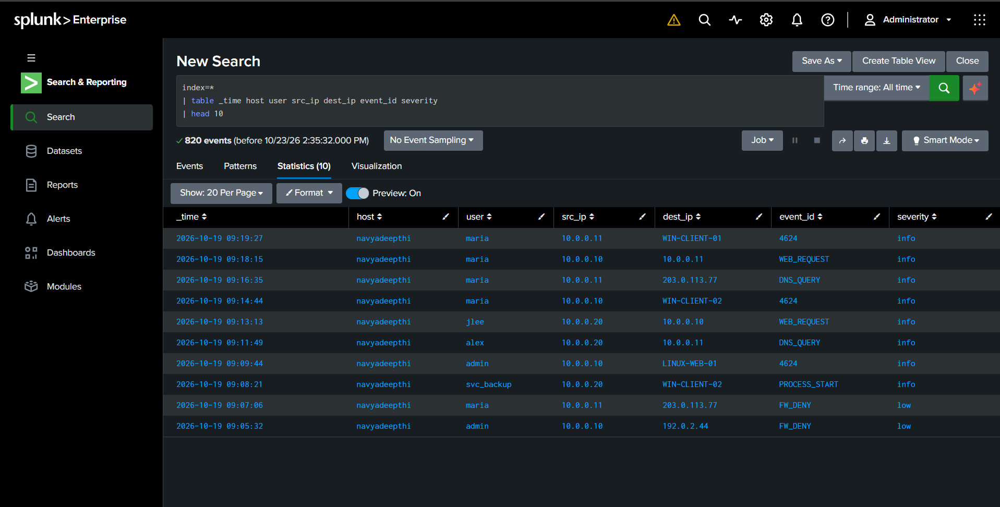
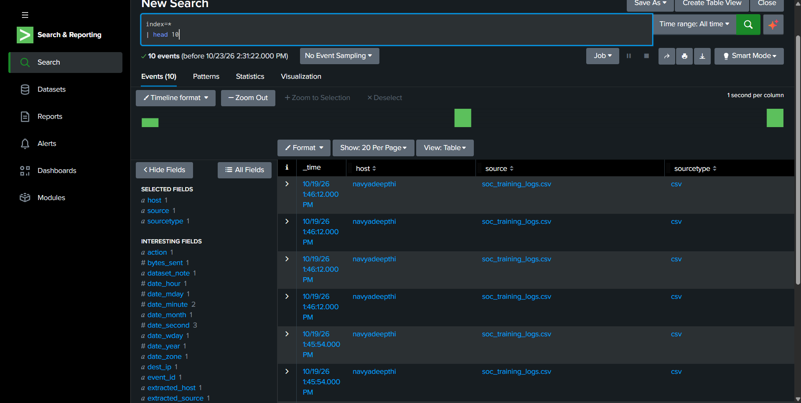

# Splunk SOC Analyst Labs 🔎

## About

This repository documents my hands-on learning journey with Splunk, focusing on security log analysis, SPL queries, and SOC investigations.

## Objectives

* Learn Splunk fundamentals and log ingestion.
* Practice Search Processing Language (SPL).
* Analyze security events and authentication logs.
* Investigate suspicious activities.
* Document findings like a SOC Analyst.

## Tools

* Splunk Enterprise
* Search Processing Language (SPL)
* CSV Log Datasets
* Windows

## Labs

| Lab | Topic                  | Status      |
| --- | ---------------------- | ----------- |
| 01  | Splunk Fundamentals    | In Progress |
| 02  | Log Ingestion          | Completed   |
| 03  | SPL Basics             | In Progress |
| 04  | Failed Login Analysis  |Completed    |
| 05  | Security Investigation | Planned     |

## Practical Evidence

### 1. Basic SPL Search

Executed a search in Splunk to retrieve events and display selected fields, including usernames, source IPs, destination IPs, event IDs, and severity.

### 2. Search Results

Reviewed the returned events to verify that the selected fields were displayed correctly.

## Disclaimer

Educational project using sample log data. Findings require investigation before being treated as confirmed security incidents.

